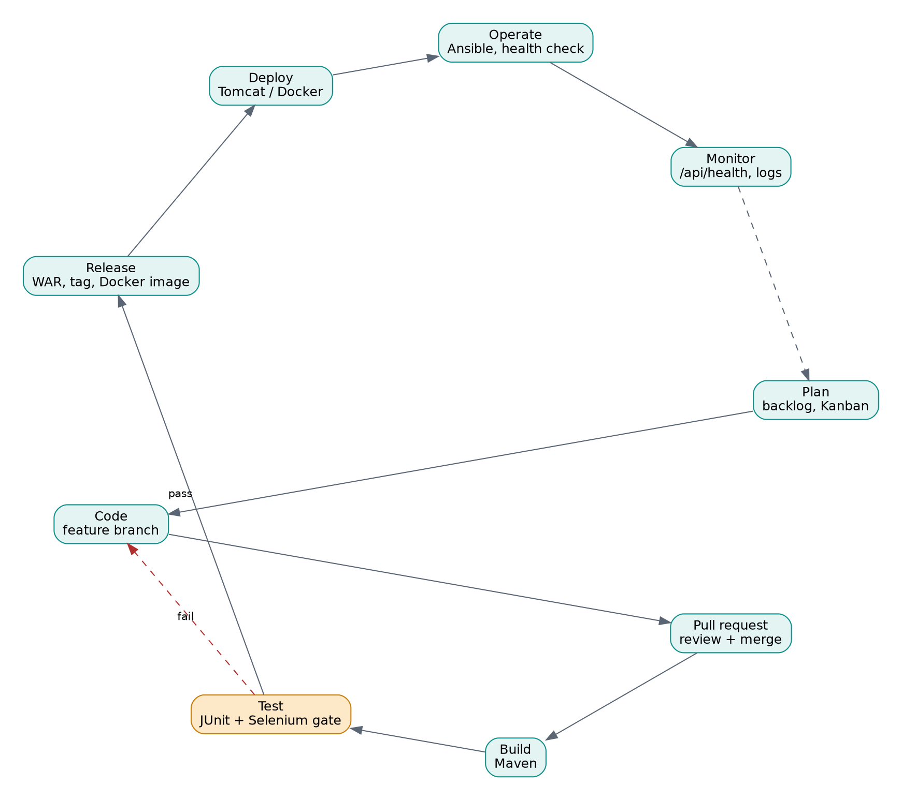
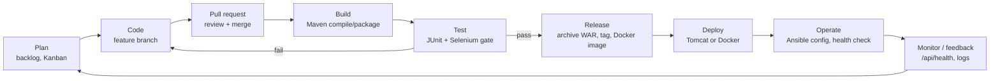

# Task 2 - Agile Planning and DevOps Workflow

> Owner / Author: **Prasana Shangloo** (23102A0076) | Copyright (c) 2026

## User stories and acceptance criteria
| ID | User story | Acceptance criteria |
|---|---|---|
| US1 | As a diner, I want to register so that I can book | Given a new email, when I submit name/email/password(6+), then I see "Registration successful". Duplicate email -> error. |
| US2 | As a diner, I want to log in | Valid credentials -> I see my name; invalid -> "Invalid email or password". |
| US3 | As a diner, I want to see free slots for a date and party size | Only tables that fit the party are shown; booked slots are disabled. |
| US4 | As a diner, I want to request a booking | Free slot click creates a booking with status PENDING; a taken slot returns 409; past dates rejected. |
| US5 | As a diner, I want to confirm a pending booking | PENDING -> CONFIRMED; any other status -> error. |
| US6 | As a diner, I want to cancel a booking | Booking -> CANCELLED and the slot becomes available again. |
| US7 | As a diner, I want to track my bookings | "My bookings" lists all bookings newest first with status. |
| US8 | As an operator, I want a health endpoint | `/api/health` returns `{"status":"UP","environment":..,"version":..}`. |

## Product backlog (prioritised)
| Priority | Item | Story | Estimate (pts) |
|---|---|---|---|
| 1 | Repo skeleton, build, health endpoint | US8 | 2 |
| 2 | Registration + login | US1, US2 | 3 |
| 3 | Availability view | US3 | 3 |
| 4 | Booking request + double-booking guard | US4 | 5 |
| 5 | Confirm / cancel | US5, US6 | 3 |
| 6 | My bookings / status tracking | US7 | 2 |
| 7 | Jenkins CI job | - | 3 |
| 8 | Jenkinsfile + Tomcat deploy | - | 3 |
| 9 | Selenium suite | - | 5 |
| 10 | Selenium gate in Jenkins | - | 3 |
| 11 | Dockerfile | - | 2 |
| 12 | Jenkins -> Docker CD | - | 3 |
| 13 | Ansible provisioning | - | 3 |
| 14 | Idempotency + rollback | - | 3 |
| 15 | Final docs + demo | - | 3 |
| Later | Notifications, admin UI, payments | - | - |

## 15-task Kanban board (Scrum plan: 3 sprints x 5 tasks)
| Sprint | Goal | Tasks |
|---|---|---|
| Sprint 1 - Foundation | Scope, plan, design, repo, first feature | 1, 2, 3, 4, 5 |
| Sprint 2 - Build and CI | Complete MVP, Jenkins CI, pipeline, tests | 6, 7, 8, 9, 10 |
| Sprint 3 - Ship and operate | Docker, CD, config mgmt, release | 11, 12, 13, 14, 15 |

Board columns: `Backlog -> Ready -> In progress -> In review (PR) -> Testing (Jenkins) -> Done`. Use a GitHub Project board with one card per task; move a card to Done only when the Definition of Done is met.

## Definition of Done
A task/story is done when:
1. Code is on a feature branch, reviewed in a pull request and merged into `develop`.
2. `mvn clean verify` passes locally and in Jenkins (unit + Selenium).
3. Acceptance criteria demonstrated (screenshot, log or report attached to the task).
4. Documentation/README updated.
5. No failing build on `develop`; deployable artefact archived.

## DevOps lifecycle workflow (development to operations)

Editable source (Mermaid):

