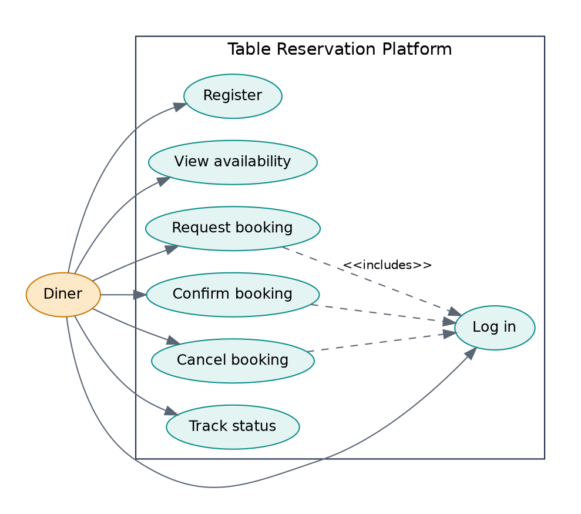
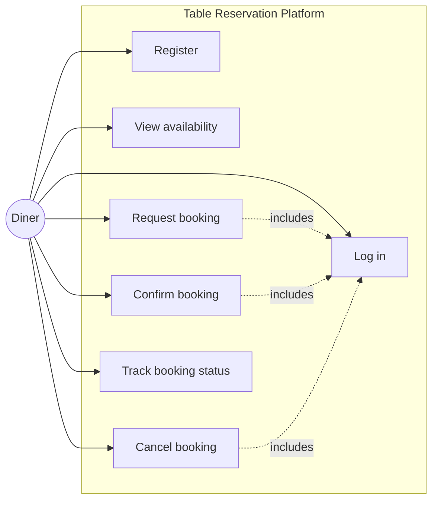
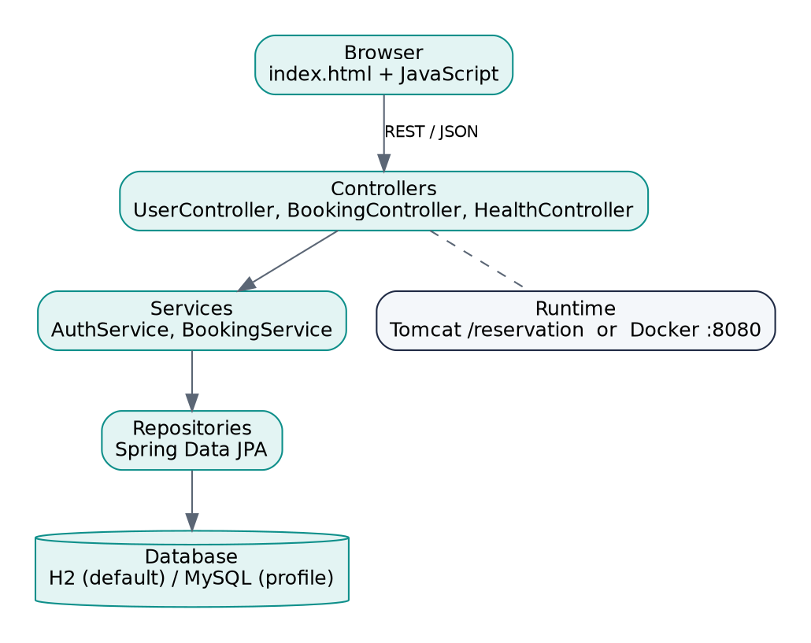
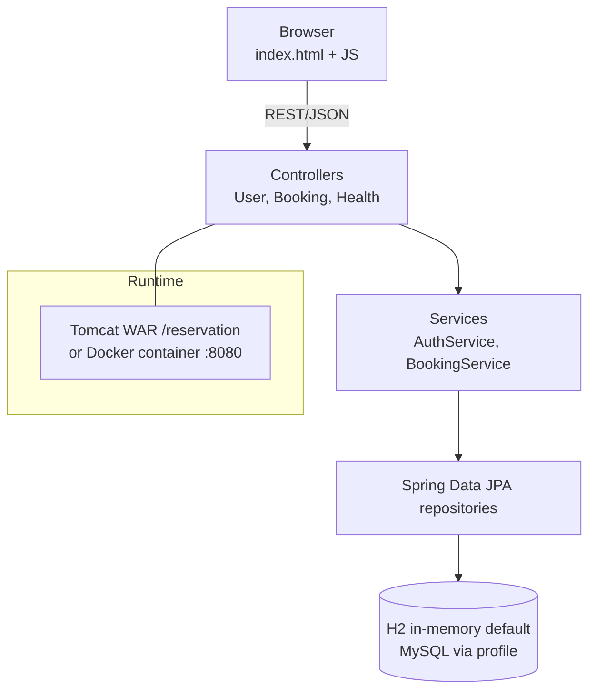
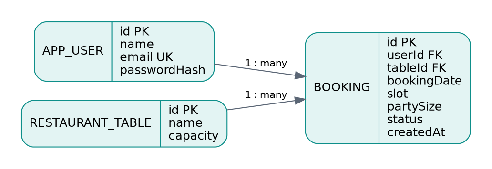
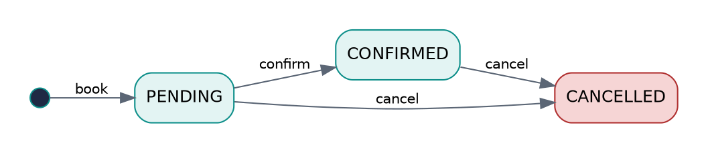
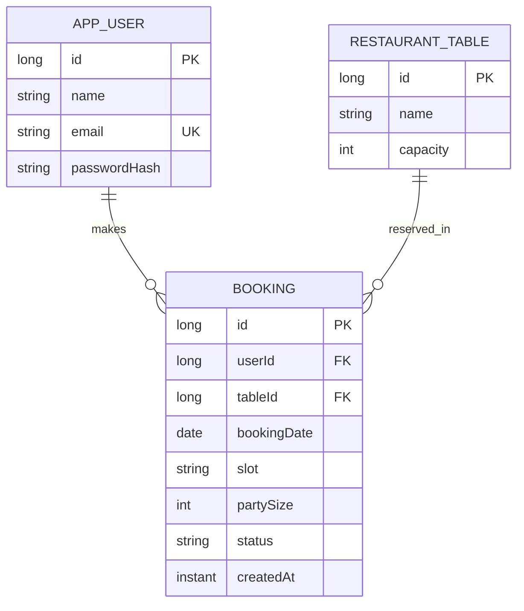

# Task 3 - Requirements, Architecture and Technology Setup

> Owner / Author: **Prasana Shangloo** (23102A0076) | Copyright (c) 2026

## SRS summary
### Functional requirements
| ID | Requirement |
|---|---|
| FR1 | The system shall let a visitor register with name, unique email and password (min 6 chars). Passwords are stored as BCrypt hashes. |
| FR2 | The system shall authenticate a user and issue a session token (`X-Auth-Token`). |
| FR3 | The system shall show, for a date and party size, every table that fits and which slots are free. |
| FR4 | The system shall create a booking in status PENDING for a free table/date/slot and reject duplicates (409) and past dates (400). |
| FR5 | The system shall allow the owner to confirm a PENDING booking. |
| FR6 | The system shall allow the owner to cancel a non-cancelled booking and release the slot. |
| FR7 | The system shall list the user's bookings with status. |
| FR8 | The system shall expose `/api/health`. |

### Non-functional requirements
Usability (single page, <3 clicks to book), reliability (health check + rollback), portability (WAR on Tomcat or Docker image), testability (automated API and UI tests), security basics (hashed passwords, ownership checks - 403 for other users' bookings).

## Use-case diagram


Editable source (Mermaid):


## Architecture diagram


Editable source (Mermaid):

Layers: **web** (controllers, DTO validation, error handler) -> **service** (business rules) -> **repo** (JPA) -> **database**.

## Technology choices
| Concern | Choice | Reason |
|---|---|---|
| Language/framework | Java 17, Spring Boot 3.2 | Mature, WAR + executable JAR, easy testing |
| Build | Maven | Matches Jenkins/Selenium/failsafe lifecycle |
| Database | H2 in-memory (default), MySQL (profile `mysql`) | Zero setup for CI; real DB for production |
| UI | Static HTML + vanilla JS | No Node toolchain; simple Selenium targets |
| Deployment | Tomcat 10.1 (WAR) and Docker | Both required by tasks 8 and 11-12 |
| CI/CD | Jenkins pipeline-as-code | Task 7-12 |
| UI tests | Selenium WebDriver 4 + JUnit 5 + headless Chrome | Task 9-10 |
| Config mgmt | Ansible (+ community.docker) | Task 13-14 |

## Data model




Editable source (Mermaid):

Slots (fixed): 12:00, 13:00, 14:00, 18:00, 19:00, 20:00, 21:00. Status: PENDING -> CONFIRMED -> (CANCELLED from PENDING or CONFIRMED).

## API list
| Method | Path | Auth | Purpose | Success |
|---|---|---|---|---|
| POST | `/api/users/register` | no | Register | 201 |
| POST | `/api/users/login` | no | Login, returns `{token,userId,name}` | 200 |
| GET | `/api/availability?date=YYYY-MM-DD&partySize=N` | no | Tables + slot availability | 200 |
| POST | `/api/bookings` | token | Create booking `{tableId,date,slot,partySize}` | 201 |
| GET | `/api/bookings` | token | My bookings | 200 |
| GET | `/api/bookings/{id}` | token | One booking | 200 |
| POST | `/api/bookings/{id}/confirm` | token | PENDING -> CONFIRMED | 200 |
| POST | `/api/bookings/{id}/cancel` | token | -> CANCELLED | 200 |
| GET | `/api/health` | no | Health, environment, version | 200 |

Errors: `{"error":"message"}` with 400 / 401 / 403 / 404 / 409.

## Local development setup
```bash
# prerequisites: JDK 17+, Maven 3.9+, Chrome (for Selenium), Docker (later tasks)
mvn clean package            # builds target/reservation.war + runs unit/API tests
java -jar target/reservation.war
# open http://localhost:8080  and  http://localhost:8080/api/health
# MySQL instead of H2:
#   DB_HOST=localhost DB_USER=reservation DB_PASSWORD=... java -jar target/reservation.war --spring.profiles.active=mysql
```
Evidence for the "working local setup" deliverable: screenshot of the app in the browser and the `mvn clean package` BUILD SUCCESS log.
